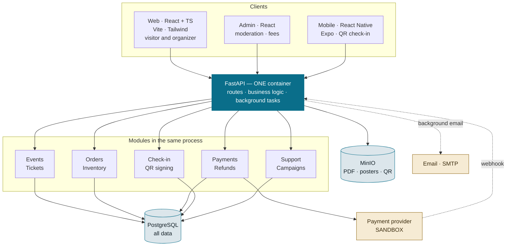
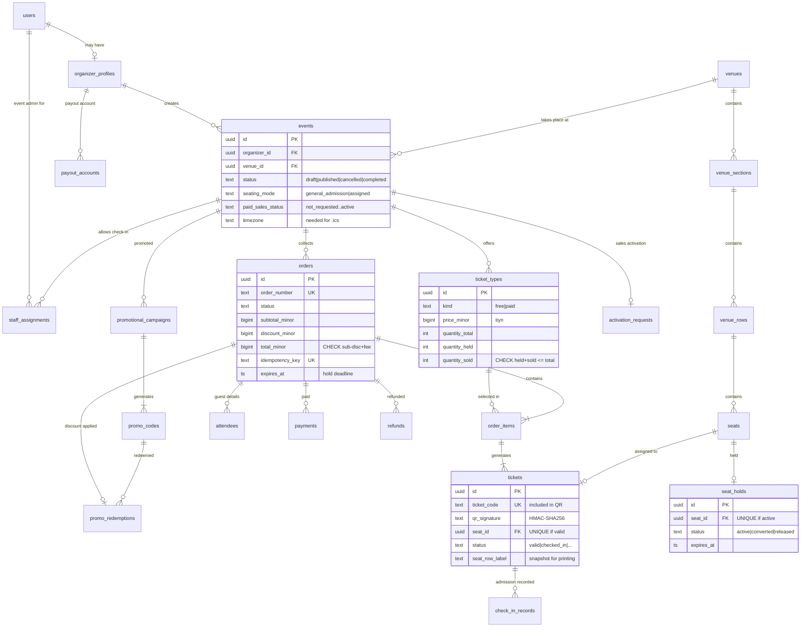
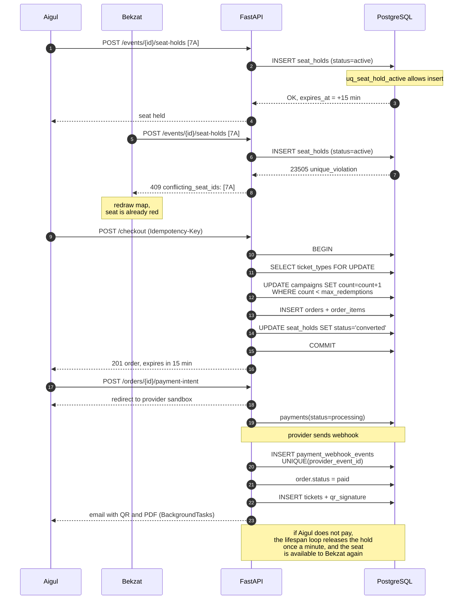
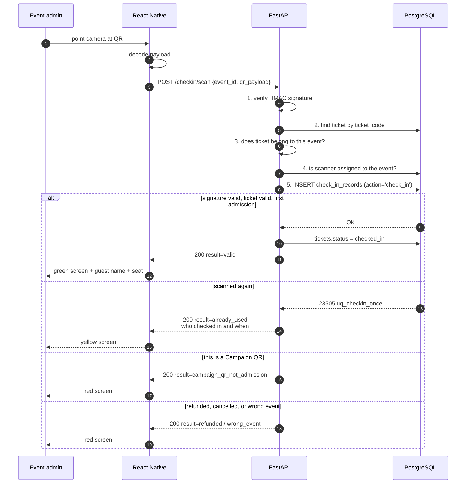
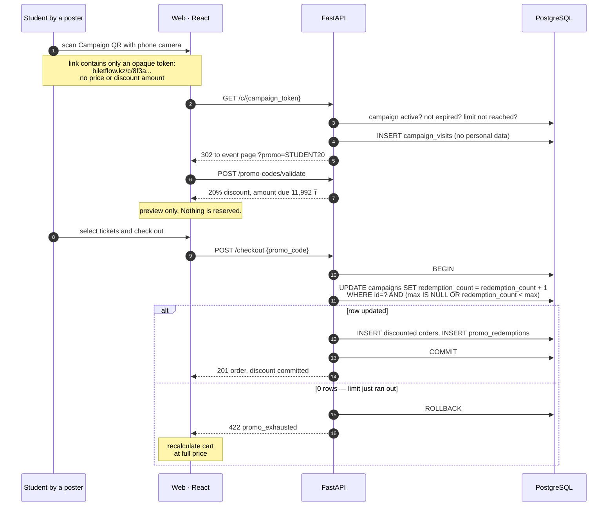
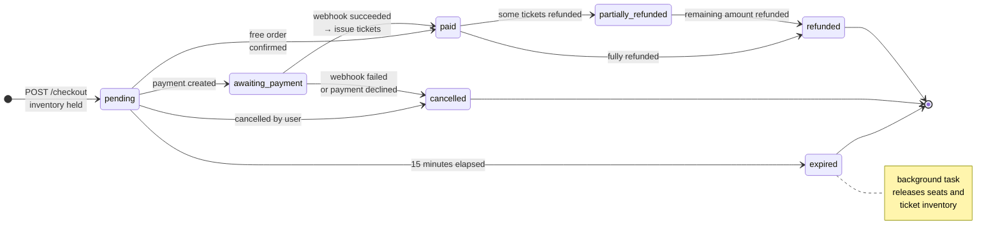
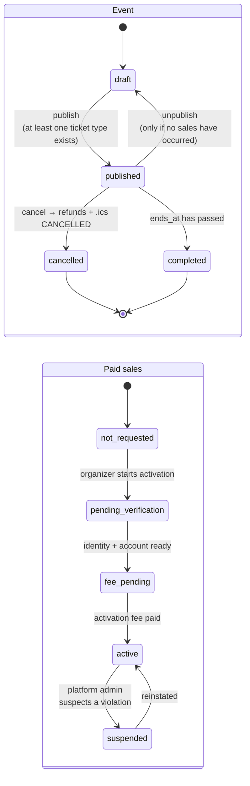

# BiletFlow

What to build, in what order, and where the project will fall apart if implemented naively. Data model, service boundaries, API, and a week-by-week plan—before the first line of business logic is written.

| | |
|---|---|
| Basis | SRS draft v0.3 |
| MVP timeline | 10–12 weeks |
| Team | 5 people |
| Region, currency | Kazakhstan, KZT |
| Backend | Python 3.12 · FastAPI · PostgreSQL 16 |
| Web | React 18 · TypeScript · Vite · Tailwind |
| Mobile app | React Native · Expo |
| File storage | MinIO (S3-compatible, local) |
| Payments | Provider sandbox or clearly labeled simulation |

---
## 1. Where to start

The first things to lock down are the **data model and API contract**. Five people cannot work in parallel until they agree on what an order looks like and what checkout returns.

The SRS describes 25 entities and four roles. If you start by coding screens, by week five the web app will have one order form, the mobile app another, and the backend will support neither.

### Core first

The full schema has 34 tables; the full API has 92 methods. Building all of it at once is not viable. Split the work into two phases: first, the pieces needed to complete the main flow; then everything else, one feature at a time.

| Phase 1 — core (11 tables, ~20 methods) | Phase 2 — after the core works |
|---|---|
| Accounts and organizer profile | Assigned seats and venue map (5 tables) |
| Event: create, publish, cancel | Promo codes and Campaign QR (5 tables) |
| Ticket types and inventory | Support chat (2 tables) |
| Order, sandbox payment, ticket with QR issuance | Refunds, payouts, activation fee |
| Mobile QR check-in | Notifications, audit, analytics, calendar |

The core is in `schema-core.sql`—eleven tables: `users`, `organizer_profiles`, `events`, `staff_assignments`, `ticket_types`, `orders`, `order_items`, `attendees`, `tickets`, `check_in_records`, and `payments`. A venue is represented by just two text fields, paid-sales activation by one `BOOLEAN`, and email-confirmation tokens by a column in `users`. Everything that could be simplified has been simplified.

> **What is not simplified.** Four protections remain even in the core: you cannot sell more than you have; a free ticket cannot cost money; each ticket grants admission exactly once; and a repeated webhook cannot issue a second set of tickets. This is not needless complexity—it is why you need a database instead of a JSON file.

### Week 1 — foundation

1. **Repository and Docker.** One monorepo, three packages: `api/`, `web/`, `mobile/`. From day one, `docker-compose up` should start Postgres, the API, and the web app with one command.
2. **Database schema in Alembic.** Take `schema-core.sql` and make it the first migration. Keep the full `schema.sql` alongside it as the picture of where the system can grow.
3. **OpenAPI as the initial contract.** Put `openapi.yaml` in the repository. The web and mobile teams generate types from it and run a mock server without waiting for the backend. Once code exists, it becomes the source of truth: FastAPI serves the spec at `/openapi.json`. Do not maintain YAML by hand; it will be stale within a week.
4. **Authentication.** Registration, email confirmation, JWT, and FastAPI dependencies for role checks. This blocks everyone else, so do it first.

### Week 2 — vertical slice

Build one small but *end-to-end* feature: an organizer creates a free event → a visitor registers → an email with a QR code arrives → an event admin scans it in the app and sees “Admission allowed.” No payments, assigned seats, or promo codes.

> **Why this slice.** It touches all five parts of the system: API, organizer web app, visitor web app, email, and mobile app. Once it works, you add features to a live skeleton instead of trying to assemble five pieces at the end of the semester. It is also the primary demo scenario in SRS §13.4.

> **What not to do in the first weeks.** Do not start the seat map, promo campaigns, or analytics. In the SRS plan these are weeks 7–9, and they are explicitly the first features to cut if the project falls behind. The seat map is the most expensive feature and the only one where a design mistake is immediately visible to users.

---

## 2. Architecture

One backend, three clients. Microservices are explicitly ruled out by the course constraints (SRS §9), and they are unnecessary here: the platform has one transactional database and one source of truth for inventory.



### Why a modular monolith instead of microservices

- **Inventory needs transactions.** “Check stock → hold a seat → apply a promo code → create an order” must be one ACID transaction. Split it across services and you need a saga with compensating actions. That is not realistic in 12 weeks.
- **Module boundaries still matter.** Modules do not reach directly into each other’s tables; they interact through the neighboring module’s service layer. If you later want to extract a service after the course, the boundaries are already drawn.

### Three infrastructure containers

No Redis, Celery, message broker, or separate scheduler. Postgres stores data, MinIO stores files, and FastAPI handles the rest. Fewer containers mean fewer things that can break an hour before the project defense.

```yaml
services:
  db:       postgres:16     # all data
  storage:  minio/minio     # ticket PDFs, posters, QR images
  api:      ./api           # FastAPI: routes + background tasks
  web:      ./web           # React, development only
```

MinIO is S3 on your machine. It uses the same protocol as Amazon S3, so the code can use `boto3` and move to real S3 by changing three environment variables. For the project defense, everything starts with one command and no internet connection.

### Background tasks without a queue

The HTTP checkout response should not wait for a PDF to be generated or an email to be sent. But that does not require a queue; FastAPI already provides enough.

| Task | Implementation |
|---|---|
| Issue tickets after payment | **Synchronously**, directly in the webhook handler. It is a few `INSERT`s and takes milliseconds. A queue here would only add another way to lose tickets. |
| Ticket email and PDF rendering | FastAPI `BackgroundTasks`: return the response immediately, then run the task in the same process. |
| Release expired holds and orders | An `asyncio` loop started in `lifespan`. One `UPDATE` per minute. No scheduler needed. |
| Organizer analytics | Calculate on demand when the dashboard opens. No materialized views or recalculation jobs; PostgreSQL responds in milliseconds at course-project scale. |

```python
@asynccontextmanager
async def lifespan(app: FastAPI):
    task = asyncio.create_task(sweep_expired())   # starts with the app
    yield
    task.cancel()

async def sweep_expired():
    while True:
        async with session() as db:
            await db.execute(text("""
                UPDATE seat_holds SET status = 'expired'
                WHERE status = 'active' AND expires_at < now()
            """))
            await db.commit()
        await asyncio.sleep(60)
```

> **The one drawback of this approach.** If the process restarts between the response and the email being sent, the email is lost. The tickets have already been issued and are in the database; only delivery is lost. A “resend tickets” button (`POST /orders/{id}/resend-tickets`) covers this. It is needed anyway: email ends up in spam much more often than it is lost due to a restart.

---

## 3. Data model

34 tables, with fourteen in the core. The full DDL, including indexes and constraints, is in `schema.sql`.



### Four decisions to make now

#### Store money as integers in tiyn

Store all amounts as `BIGINT` in tiyn: 15,000 ₸ is `1500000`. Never use `float` for calculations. A 20% discount on three 4,990 ₸ tickets can produce a floating-point total that does not reconcile with the order line items, and you could spend a week tracking down the discrepancy.

#### Put invariants in the database, not only in code

Express key constraints as `CHECK` constraints and partial unique indexes. Even if two requests arrive at once and the code checks inventory identically, the second insert will fail on the index.

| Protection | PostgreSQL mechanism |
|---|---|
| One active hold per seat | `UNIQUE (event_id, seat_id) WHERE status='active'` |
| One valid ticket per seat | `UNIQUE (event_id, seat_id) WHERE status IN ('valid','checked_in')` |
| Cannot sell more than available | `CHECK (quantity_held + quantity_sold <= quantity_total)` |
| One admission per ticket | `UNIQUE (ticket_id) WHERE action='check_in'` |
| Order total reconciles with its line items | `CHECK (total = subtotal − discount + fee)` |
| Campaign redemption limit is enforced | `CHECK (redemption_count <= max_redemptions)` |
| Free tickets cannot cost money | `CHECK (kind='free' AND price=0 OR kind='paid' AND price>0)` |
| Duplicate webhook cannot issue another ticket | `UNIQUE (provider, provider_event_id)` |

All eight were tested against a live PostgreSQL 16 database by attempting to violate them; the database rejected each attempt.

#### Snapshot the seat on the ticket

In `tickets`, store text fields `seat_section_name`, `seat_row_label`, and `seat_label` alongside `seat_id`. An organizer might rename a row after tickets are sold; already-printed tickets should not become inaccurate.

#### History is an append-only table

The event activity feed (SRS §4.16) and audit log (SRS §7) use one `audit_log` table that the application only inserts into. In the production migration, revoke `UPDATE` and `DELETE` on it from the application role. Full field-level versioning is not required for the MVP.

### Full table list

| Group | Tables |
|---|---|
| Users and roles | `users`, `auth_tokens`, `organizer_profiles`, `payout_accounts` |
| Venues and seats | `venues`, `venue_sections`, `venue_rows`, `seats` |
| Events | `events`, `staff_assignments` |
| Tickets and inventory | `ticket_types` |
| Orders | `orders`, `order_items`, `seat_holds`, `attendees`, `tickets`, `check_in_records` |
| Money | `payments`, `payment_webhook_events`, `refunds`, `refund_items`, `activation_requests` |
| Promotions | `promotional_campaigns`, `promo_codes`, `campaign_ticket_types`, `promo_redemptions`, `campaign_visits` |
| Support | `support_cases`, `support_messages` |
| Operational | `notifications`, `audit_log` |
| Views | `v_event_sales_summary`, `v_event_attendance`, `v_campaign_performance` |

---

## 4. Three dangerous areas

Everything else in the project is ordinary CRUD. These three flows are where a naive implementation can pass a demo and fail as soon as two users act at the same time.

### A. Seat selection and checkout

A classic race: two people click seat 7 in the first row at the same time. The solution is to create the hold in the database *first*, and only then show it in the cart.



> **Rule that must not be broken.** Only the server calculates discounts. `POST /promo-codes/validate` is a preview for the interface; it reserves nothing. The promo code is actually applied and its limit consumed inside the same transaction that creates the order.

### B. QR check-in

The QR contains an opaque `ticket_code` with an HMAC signature, not `ticket.id`. Knowing the numbering scheme is not enough to forge a ticket, and the scanner itself must not make the decision.



- **A rejection is still HTTP 200.** The scanner always receives a structured `result`, not an exception. 4xx codes are reserved for actual request errors.
- **The staff member is recorded.** Every record stores `performed_by`, so the organizer can see which staff member admitted each guest.
- **Reversing a check-in does not delete the record.** It inserts a new row with `action='reversal'` and requires a separate `can_reverse_checkin` permission.

### C. Campaign QR and promo code

This is the second kind of QR in the system, and it is easy to confuse with a ticket—even though it does not grant admission.



> **Two QR codes, two different worlds.** The ticket QR contains `ticket_code` + HMAC. The Campaign QR contains `campaign_token` and points to an HTTPS URL. `/checkin/scan` must explicitly recognize the latter and return `campaign_qr_not_admission`; otherwise someone could enter a concert using an advertising flyer. This needs its own required test.

---

## 5. Lifecycles

These are three finite-state machines worth coding explicitly: transitions are allowed only along the arrows; all others are rejected by the service layer.

### Order statuses



### Event and paid-sales activation



These are **two independent axes**. An event can be published and sell free tickets while paid sales are not yet activated. That is the point of the monetization model in SRS §3: everything is free until you are ready to earn money.

A ticket is simpler: `valid → checked_in` on first admission, `valid → cancelled | refunded` on cancellation or refund. There is no path back from `refunded`; an erroneous check-in is reversed with a `reversal` record, which returns the ticket to `valid`.

---

## 6. API methods

78 operations in 15 modules. The full specification is in `openapi.yaml` (valid OpenAPI 3.1 and viewable in Swagger UI). Here are the methods to keep in mind; routine CRUD is omitted.

| Method | Path | What it does |
|---|---|---|
| POST | `/auth/register` | Registration and confirmation email |
| POST | `/auth/login` | JWT pair; refresh token in an httpOnly cookie |
| GET | `/me` | Profile, global role, and events where the user is an event admin |
| GET | `/events` | Public search: city, category, dates, free events |
| POST | `/events` | Create a draft |
| POST | `/events/{id}/publish` | Publish; 422 if no ticket types exist |
| POST | `/events/{id}/cancel` | Cancel: invalidate tickets, create refunds, send notifications |
| POST | `/events/{id}/duplicate` | Clone as draft without orders, tickets, or check-ins |
| GET | `/events/{id}/history` | Activity feed filterable by date and action type |
| POST | `/events/{id}/staff` | Assign an event admin by email |
| GET | `/events/{id}/attendees` | Guest list: search and filter by ticket type and admission status |
| GET | `/events/{id}/seatmap` | Sections, rows, seats, statuses, and prices |
| POST | `/events/{id}/seat-holds` | Atomically hold seats; 409 with conflicting seat IDs |
| GET | `/events/{id}/activation` | Paid-sales activation checklist |
| POST | `/events/{id}/activation` | Start activation and return fee payment link |
| POST | `/checkout` | **Core.** One transaction: inventory, promo code, order. Requires `Idempotency-Key` |
| POST | `/orders/{id}/payment-intent` | Start a payment in the sandbox |
| POST | `/orders/{id}/confirm-free` | Free registration: issue tickets immediately |
| POST | `/orders/{id}/refunds` | Full or partial refund for specific tickets |
| POST | `/promo-codes/validate` | Preview discount. Reserves nothing |
| GET | `/tickets/{id}/pdf` | Printable A4 ticket, large QR, readable in grayscale |
| GET | `/events/{id}/calendar.ics` | iCalendar with stable UID—updates replace the event rather than duplicate it |
| POST | `/checkin/scan` | The scanner’s only method. Rejections also return code 200 |
| GET | `/checkin/search` | Manually find a guest when QR cannot be read |
| POST | `/checkin/reverse` | Reverse an erroneous admission; requires `can_reverse_checkin` |
| GET | `/checkin/stats` | Venue counters: issued, admitted, “how many I admitted” |
| POST | `/events/{id}/campaigns` | Create campaign and generate promo code and Campaign QR |
| GET | `/c/{campaign_token}` | QR entry point: record visit and redirect to event |
| POST | `/support/cases` | Open a support case with event, order, or ticket context |
| GET | `/support/cases/{id}/messages` | Conversation; use `after` for lightweight polling instead of WebSocket |
| GET | `/events/{id}/analytics/summary` | Capacity, sales, revenue, attendance |
| GET | `/events/{id}/analytics/sales-over-time` | Sales by hour, day, or week |
| POST | `/admin/events/{id}/suspend` | Suspend event and sales |
| POST | `/webhooks/payments/{provider}` | Provider webhook. Verify signature before parsing body |

### The `servers` block in openapi.yaml

`servers` is a standard OpenAPI section that tells a client **where to send requests**. The first URL is the default: Swagger UI sends “Try it out” requests there, and client generators use it as the base URL.

For a course project, put localhost first. The second URL is a placeholder; replace it if you deploy the project, or remove the block. It does not affect whether the specification is valid.

```yaml
servers:
  - url: http://localhost:8000/v1
    description: Local development (docker-compose)
  - url: https://api.example.kz/v1
    description: Production server (address not yet decided)
```

### Cross-cutting conventions

| Convention | Details |
|---|---|
| Money | Integer tiyn in `*_minor` fields. 15,000 ₸ = `1500000` |
| Time | ISO 8601 with timezone: `2026-10-12T19:00:00+05:00` |
| Authentication | JWT `Bearer`, access token ~15 min, refresh token in httpOnly cookie |
| Idempotency | `Idempotency-Key` header on `/checkout`, `/payment-intent`, `/checkin/scan` |
| Pagination | Cursor-based: `?limit=50&cursor=…`, with `next_cursor` in the response |
| Errors | RFC 9457, `application/problem+json` |
| Authorization | Based on assignment to a specific event, not a global role |

---

## 7. Repository structure

One monorepo. Shared types are generated from `openapi.yaml`, so renaming a backend field breaks the frontend build—which is exactly what you want.

```
biletflow/
├── api/                        # FastAPI
│   ├── app/
│   │   ├── core/               # config, security, JWT, HMAC for QR
│   │   ├── db/                 # sessions, base, Alembic migrations
│   │   ├── modules/
│   │   │   ├── users/
│   │   │   ├── auth/           # router · service · schemas · models
│   │   │   ├── events/
│   │   │   ├── tickets/
│   │   │   ├── seating/        # seat map, holds
│   │   │   ├── orders/         # checkout — the most critical module
│   │   │   ├── payments/       # provider + webhooks + refunds
│   │   │   ├── checkin/
│   │   │   ├── campaigns/
│   │   │   ├── support/
│   │   │   ├── analytics/
│   │   │   └── admin/
│   │   ├── tasks.py            # BackgroundTasks + hold-release loop
│   │   └── main.py
│   ├── tests/                  # pytest + pytest-asyncio
│   └── alembic/
├── web/                        # React 18 + TS + Vite + Tailwind
│   └── src/
│       ├── api/                # client generated from openapi.yaml
│       ├── features/
│       │   ├── discover/       # search and event page
│       │   ├── checkout/       # cart, promo code, payment
│       │   ├── seatmap/        # SVG seat map
│       │   ├── organizer/      # dashboard, tickets, guests, analytics
│       │   ├── support/
│       │   └── admin/
│       └── shared/             # UI kit, hooks, i18n (kk / ru / en)
├── mobile/                     # React Native + Expo
│   └── src/
│       ├── screens/            # Login · EventPicker · Scanner · Result · Stats
│       ├── scanner/            # expo-camera, QR parsing
│       └── api/
├── docs/
│   ├── openapi.yaml            # contract shared by all three clients
│   ├── schema.sql
│   └── adr/                    # short decision records
├── docker-compose.yml
└── .github/workflows/ci.yml    # lint · types · tests · image builds
```

> **About ADRs.** Each architectural decision gets one page: context, options, choice, consequences. This is exactly what SRS §9 requires (“document the technology stack choices with brief rationale”), and it will help during the project defense when someone asks, “Why PostgreSQL rather than Mongo?”

---

## 8. Twelve weeks for five people

Responsibilities come from SRS §13.2. Each area has one owner and one team reviewer—the rule “nobody merges their own work” maintains quality without unnecessary bureaucracy.

| Person | Area of responsibility |
|---|---|
| P1 | Platform: architecture, authentication, integrations, Docker, CI, deployment |
| P2 | Core backend: events, ticket types, inventory, orders, seat holds |
| P3 | Web clients: organizer and visitor interfaces, checkout |
| P4 | Admin and reports: moderation, campaigns, analytics, history, calendar, PDF |
| P5 | Mobile and quality: check-in app, support, seats, tests, release |

| Weeks | Goal | P1 | P2 | P3 | P4 | P5 |
|---|---|---|---|---|---|---|
| **1–2** | Milestone: `docker-compose up` starts everything; schema and OpenAPI are locked | Monorepo, Docker, CI, FastAPI skeleton, JWT, roles | Data model → Alembic migrations | React scaffold, routing, UI kit, wireframes | Review `openapi.yaml`, dashboard mockups | Expo scaffold, login screen, test plan |
| **3–4** | Organizer registers, creates, and publishes an event | Email confirmation, password reset, email, S3 | Event CRUD, publishing, organizer profile | Event forms, search, public page | Admin scaffold, moderation, assign event admins | Assigned event list, e2e scaffold |
| **5–6** | Milestone: end-to-end flow from registration to QR scan | Payment sandbox, webhooks, idempotency | **Checkout transaction**, inventory, ticket issuance, HMAC | Cart, checkout, order page, “my tickets” | Guest list, CSV export, ticket emails | QR scanner, result screens, race-condition tests |
| **7** | Printing, promo codes, calendar—only if the slice is stable | Paid-sales activation, activation fee | Refunds, cancellations, ticket invalidation | Promo-code entry, calendar buttons | Ticket PDFs, `.ics`, campaigns and Campaign QR | Scanner rejection for Campaign QR, manual search |
| **8** | Check-in app complete; support chat works | Rate limiting, logs, monitoring | Reverse check-in, scan log, venue stats | Web support chat, notifications | Cases and statuses in admin | Full mobile app: search, cancellation, counters |
| **9** | Analytics and history; seats only if weeks 5–6 are complete | Indexes, query profiling | *Bonus:* seat holds, atomic booking | *Bonus:* SVG seat map, accessible labels | Analytics dashboard, activity feed, duplication | Concurrent booking tests, regression |
| **10** | Milestone: feature freeze. Build and fix only | Release images, staging | Bugs at module boundaries | Mobile layout, loading and error states | kk/ru/en localization, WCAG 2.1 AA accessibility | End-to-end tests, bug report |
| **11–12** | Buffer. Start nothing new | Backups, README, deployment guide | Checkout load test | UI polish, demo data | Documentation, ADRs, presentation | Demo rehearsal, fallback plan |

> **What to cut if behind schedule.** Per SRS §13.4, cut in this order: assigned seating → calendar export → advanced analytics → localization polish → refund simulation. Never cut the main flow: create event, distribute Campaign QR, apply promo code, check out, issue ticket, contact support, enter with QR.

---

## 9. Decide this week

These open questions from SRS §12 block development. The others can wait; these cannot.

| Question | Why it is urgent | What the schema assumes |
|---|---|---|
| Must visitors have an account? | Changes checkout and email; decide before week 5 | Guest orders are allowed: `buyer_user_id` may be `NULL`; access via signed email link |
| Must an event admin be a platform user? | Blocks staff assignment | Yes: assign by email; check-in log records staff member’s name |
| Does the organizer or visitor pay the fee? | Affects `fee_minor` and the total shown to the buyer | For MVP, simplest is no commission—only a one-time activation fee |
| What is the activation fee, and is it refundable? | A concrete amount is needed for the demo | Configurable through `/admin/settings/fees` |
| Which venue will be preloaded as a layout? | Seed data needs to be prepared in advance | Exactly one venue with sections, rows, available seats, and price categories |
| Provider sandbox or custom simulation? | Determines week 5 work | Both are supported; `payments.is_simulated` flag. Every money-related screen must be labeled as a demo. |

---

## Appendices

| File | Contents | Verification status |
|---|---|---|
| `schema-core.sql` | **Start here.** 11 core tables | Run on PostgreSQL 16; 4 protections verified by attempting to violate them |
| `schema.sql` | Full design: 34 tables, 3 views, enum types, indexes, triggers | Run on PostgreSQL 16; 8 protections verified by attempting to violate them |
| `openapi.yaml` | 78 operations, 35 schemas, 15 modules | Valid OpenAPI 3.1; suitable for generating React and React Native clients |
