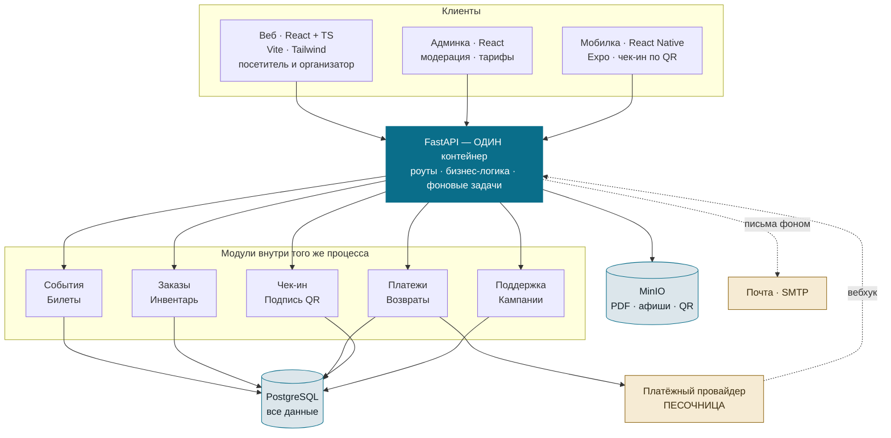
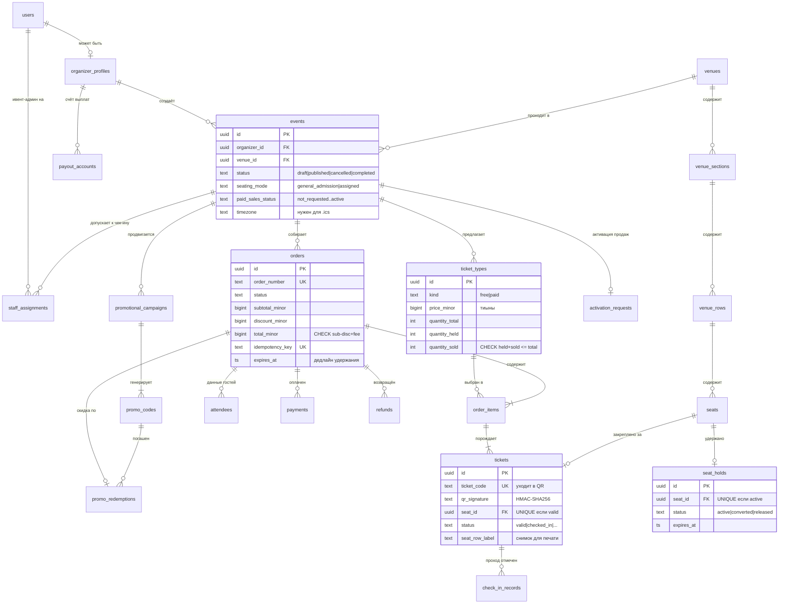
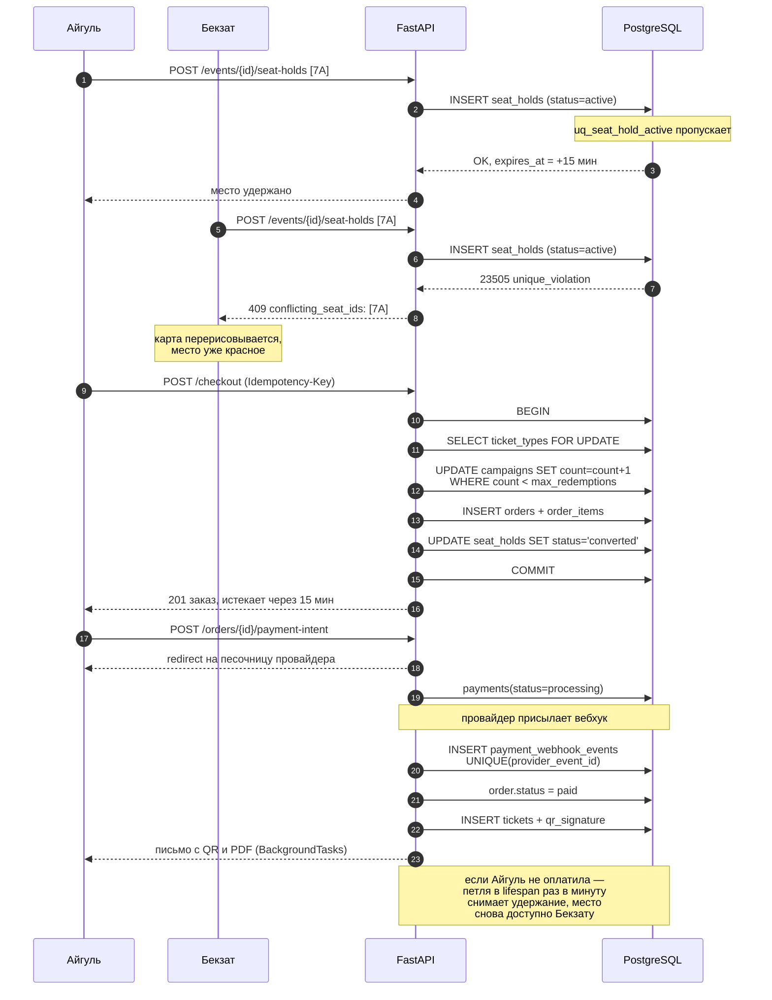
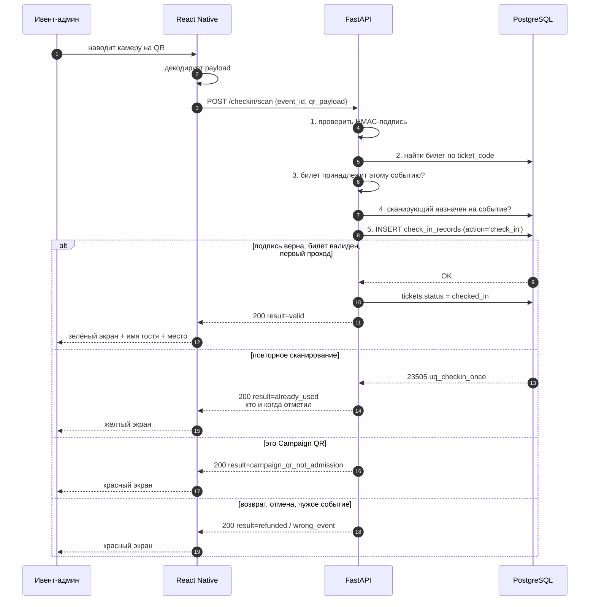
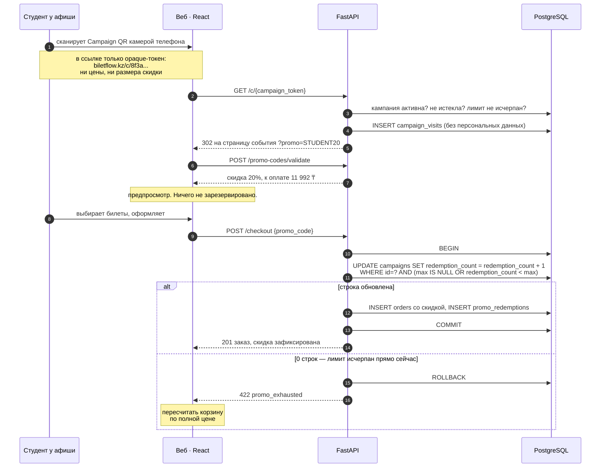
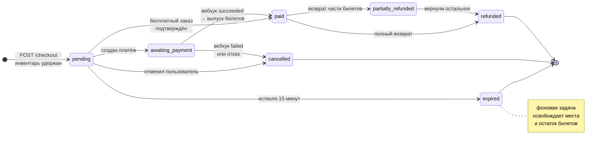
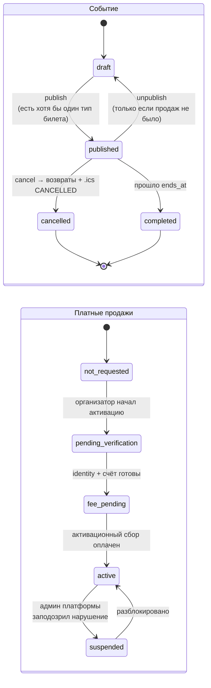

# Чертёж BiletFlow

Что строим, в каком порядке и где проект развалится, если сделать наивно. Модель данных, границы сервисов, API и понедельный план — до того, как написана первая строка бизнес-логики.

| | |
|---|---|
| Основа | Черновик SRS v0.3 |
| Срок MVP | 10–12 недель |
| Команда | 5 человек |
| Регион, валюта | Казахстан, KZT |
| Бэкенд | Python 3.12 · FastAPI · PostgreSQL 16 |
| Веб | React 18 · TypeScript · Vite · Tailwind |
| Мобильное приложение | React Native · Expo |
| Хранилище файлов | MinIO (S3-совместимое, локально) |
| Платежи | Песочница провайдера или помеченная симуляция |

---

## 1. С чего начать

Не с экранов и не с логина. Первое, что нужно зафиксировать, — **модель данных и контракт API**. Пятеро не смогут работать параллельно, пока не договорятся, как выглядит заказ и что возвращает чекаут.

SRS описывает 25 сущностей и четыре роли. Если начать с кода экранов, к пятой неделе окажется, что у веба одна форма заказа, у мобилки другая, а бэкенд не умеет ни ту, ни другую.

### Сначала — только ядро

Полная схема — 34 таблицы, полное API — 92 метода. Строить это разом нельзя. Разделите на две фазы: сначала то, без чего сценарий не проходит, потом всё остальное — по одной функции.

| Фаза 1 — ядро (11 таблиц, ~20 методов) | Фаза 2 — после того, как ядро работает |
|---|---|
| Аккаунты и профиль организатора | Назначенные места и карта зала (5 таблиц) |
| Событие: создать, опубликовать, отменить | Промокоды и Campaign QR (5 таблиц) |
| Типы билетов и остатки | Чат поддержки (2 таблицы) |
| Заказ, оплата в песочнице, выпуск билета с QR | Возвраты, выплаты, активационный сбор |
| Мобильный чек-ин по QR | Уведомления, аудит, аналитика, календарь |

Ядро лежит в `schema-core.sql` — это одиннадцать таблиц: `users`, `organizer_profiles`, `events`, `staff_assignments`, `ticket_types`, `orders`, `order_items`, `attendees`, `tickets`, `check_in_records`, `payments`. Площадка в нём — просто две текстовые строки, активация платных продаж — один `BOOLEAN`, токены подтверждения почты — колонка в `users`. Всё, что можно было свернуть, свёрнуто.

> **Что при этом не упрощается.** Четыре защиты остаются даже в ядре: нельзя продать больше, чем есть; бесплатный билет не может стоить денег; один билет пропускает ровно один раз; повторный вебхук не выпускает второй комплект билетов. Это не усложнение — это то, ради чего вообще нужна база вместо файла с JSON.

### Неделя 1 — фундамент

1. **Репозиторий и Docker.** Один monorepo, три пакета: `api/`, `web/`, `mobile/`. `docker-compose up` должен поднимать Postgres + API + веб одной командой с первого дня.
2. **Схема БД в Alembic.** Берёте `schema-core.sql`, он и становится первой миграцией. Полный `schema.sql` держите рядом как картину, куда растёте.
3. **OpenAPI как договор на старте.** `openapi.yaml` кладётся в репозиторий, фронт и мобилка генерируют из него типы и поднимают мок-сервер, не дожидаясь бэкенда. Как только появится код, источником правды станет он: FastAPI отдаёт спеку сам на `/openapi.json`, вручную вести yaml не надо — он протухнет за неделю.
4. **Аутентификация.** Регистрация, подтверждение почты, JWT, зависимости FastAPI для проверки ролей. Это блокирует всех остальных, поэтому делается первым.

### Неделя 2 — вертикальный срез

Одна тонкая, но *сквозная* функция целиком: организатор создаёт бесплатное событие → посетитель регистрируется → приходит письмо с QR → ивент-админ сканирует его в приложении и видит «Проход разрешён». Без оплат, без мест, без промокодов.

> **Зачем именно так.** Этот срез задевает все пять частей системы: API, веб организатора, веб посетителя, почту и мобильное приложение. Как только он работает, дальше вы наращиваете функции на живом скелете, а не собираете пять кусков в конце семестра. Это же и есть основной сценарий демонстрации из §13.4 SRS.

> **Чего не делать в первые недели.** Не браться за карту мест, промо-кампании и аналитику. По плану SRS это недели 7–9, и они честно помечены как то, что вырезается первым, если проект отстаёт. Карта мест — самая дорогая функция в проекте и единственная, где ошибка проектирования заметна пользователю сразу.

---

## 2. Архитектура

Один бэкенд, три клиента. Микросервисы прямо запрещены рамками курса (§9 SRS) и здесь не нужны: у платформы одна транзакционная база и один источник правды по инвентарю.



### Почему модульный монолит, а не микросервисы

- **Инвентарь требует транзакций.** «Проверить остаток → удержать место → применить промокод → создать заказ» должно быть одной ACID-транзакцией. Разнесите это по сервисам — и придётся писать сагу с компенсациями. За 12 недель это не делается.
- **Границы модулей всё равно нужны.** Модули не лезут в чужие таблицы напрямую: только через сервисный слой соседа. Если после курса захотите вынести что-то в сервис — границы уже прочерчены.

### Вся инфраструктура — три контейнера

Ни Redis, ни Celery, ни брокера, ни отдельного планировщика. Postgres хранит данные, MinIO хранит файлы, FastAPI делает всё остальное. Меньше контейнеров — меньше того, что сломается за час до защиты.

```yaml
services:
  db:       postgres:16     # все данные
  storage:  minio/minio     # PDF-билеты, афиши, картинки QR
  api:      ./api           # FastAPI: роуты + фоновые задачи
  web:      ./web           # React, только для разработки
```

MinIO — это S3 у вас на машине. Тот же протокол, что у Amazon S3, поэтому код пишется через `boto3` и при желании переезжает на настоящий S3 сменой трёх переменных окружения. На защите же всё поднимается одной командой без интернета.

### Фоновые задачи без очереди

HTTP-ответ на чекаут не должен ждать генерации PDF или отправки письма. Но очередь для этого не нужна — хватает того, что уже есть в FastAPI.

| Задача | Как делается |
|---|---|
| Выпуск билетов после оплаты | **Синхронно**, прямо в обработчике вебхука. Это несколько `INSERT` — они занимают миллисекунды. Очередь здесь только добавила бы способ потерять билеты |
| Письмо с билетом, рендер PDF | `BackgroundTasks` FastAPI: ответ уходит сразу, задача выполняется после него в том же процессе |
| Снятие истёкших удержаний и заказов | Петля `asyncio`, запущенная в `lifespan`. Раз в минуту один `UPDATE`. Планировщик не нужен |
| Аналитика организатора | Считается запросом в момент открытия дашборда. Никаких витрин и пересчётов: на учебных объёмах PostgreSQL отвечает за миллисекунды |

```python
@asynccontextmanager
async def lifespan(app: FastAPI):
    task = asyncio.create_task(sweep_expired())   # стартует вместе с приложением
    yield
    task.cancel()

async def sweep_expired():
    while True:
        async with session() as db:
            await db.execute(text("""
                UPDATE seat_holds SET status = 'expired'
                WHERE status = 'active' AND expires_at < now()
            """))
            await db.commit()
        await asyncio.sleep(60)
```

> **Единственный минус такого подхода.** Если процесс перезапустится ровно между ответом и отправкой письма, письмо потеряется. Билеты при этом уже выпущены и лежат в базе — теряется только доставка. Закрывается кнопкой «выслать билеты повторно» (`POST /orders/{id}/resend-tickets`), которая всё равно нужна: письма теряются в спаме гораздо чаще, чем от перезапусков.

---

## 3. Модель данных

34 таблицы, из них ядро — четырнадцать. Полный DDL с индексами и ограничениями лежит в `schema.sql`.



### Четыре решения, которые стоит принять сейчас

#### Деньги — целые числа в тиынах

Все суммы хранятся как `BIGINT` в тиынах: 15 000 ₸ — это `1500000`. Никаких `float` для расчётов. 20% скидки от трёх билетов по 4 990 ₸ в плавающей точке дадут итог, который не сойдётся с суммой строк заказа, и вы будете это ловить неделю.

#### Инварианты живут в базе, а не только в коде

Ключевые ограничения выражены как `CHECK` и частичные уникальные индексы. Даже если два запроса придут одновременно и код проверит остаток одинаково, вторая вставка упадёт на индексе.

| Что защищаем | Механизм в PostgreSQL |
|---|---|
| Одно место — одно активное удержание | `UNIQUE (event_id, seat_id) WHERE status='active'` |
| Одно место — один действующий билет | `UNIQUE (event_id, seat_id) WHERE status IN ('valid','checked_in')` |
| Нельзя продать больше, чем есть | `CHECK (quantity_held + quantity_sold <= quantity_total)` |
| Один билет — один проход | `UNIQUE (ticket_id) WHERE action='check_in'` |
| Итог заказа сходится со строками | `CHECK (total = subtotal − discount + fee)` |
| Лимит промокампании не превышается | `CHECK (redemption_count <= max_redemptions)` |
| Бесплатный билет не может стоить денег | `CHECK (kind='free' AND price=0 OR kind='paid' AND price>0)` |
| Повторный вебхук не выпустит второй билет | `UNIQUE (provider, provider_event_id)` |

Все восемь проверены на живой PostgreSQL 16 попыткой их нарушить — база отвергла каждую.

#### Снимок места в билете

В `tickets` рядом с `seat_id` лежат текстовые `seat_section_name`, `seat_row_label`, `seat_label`. Организатор может переименовать ряд после продаж — уже напечатанный билет от этого «поехать» не должен.

#### История — это append-only таблица

Лента активности события (§4.16) и аудит (§7) — одна таблица `audit_log`, куда приложение только вставляет. В продовой миграции у роли приложения отзываются `UPDATE` и `DELETE` на неё. Полной версионности полей MVP не требует.

### Полный список таблиц

| Группа | Таблицы |
|---|---|
| Пользователи и роли | `users`, `auth_tokens`, `organizer_profiles`, `payout_accounts` |
| Площадки и места | `venues`, `venue_sections`, `venue_rows`, `seats` |
| События | `events`, `staff_assignments` |
| Билеты и инвентарь | `ticket_types` |
| Заказы | `orders`, `order_items`, `seat_holds`, `attendees`, `tickets`, `check_in_records` |
| Деньги | `payments`, `payment_webhook_events`, `refunds`, `refund_items`, `activation_requests` |
| Промо | `promotional_campaigns`, `promo_codes`, `campaign_ticket_types`, `promo_redemptions`, `campaign_visits` |
| Поддержка | `support_cases`, `support_messages` |
| Служебное | `notifications`, `audit_log` |
| Представления | `v_event_sales_summary`, `v_event_attendance`, `v_campaign_performance` |

---

## 4. Три опасных места

Остальное в проекте — обычный CRUD. Эти три потока — те, где наивная реализация проходит демонстрацию и ломается при двух одновременных пользователях.

### А. Выбор места и чекаут

Классическая гонка: двое одновременно жмут на кресло 7 в первом ряду. Решение — *сначала* взять удержание в базе, и только потом показывать корзину.



> **Правило, которое нельзя нарушать.** Скидку считает только сервер. `POST /promo-codes/validate` — это предпросмотр для интерфейса, он ничего не резервирует. Реальное применение промокода и списание лимита происходят внутри той же транзакции, что и создание заказа.

### Б. Чек-ин по QR

В QR лежит не `ticket.id`, а непрозрачный `ticket_code` с HMAC-подписью. Подделать билет, зная схему нумерации, невозможно; сканер при этом не должен ничего решать сам.



- **Отказ — это тоже HTTP 200.** Сканер всегда получает структурированный `result`, а не исключение. Коды 4xx остаются для настоящих ошибок вызова.
- **Кто отметил — видно.** Каждая запись хранит `performed_by`, поэтому организатор видит, кто из сотрудников сколько гостей провёл.
- **Отмена прохода не удаляет запись,** а добавляет новую с `action='reversal'` и требует отдельного права `can_reverse_checkin`.

### В. Campaign QR и промокод

Это второй тип QR в системе, и его легко перепутать с билетом — а он не даёт прохода.



> **Два QR — две вселенные.** Билетный QR содержит `ticket_code` + HMAC. Campaign QR содержит `campaign_token` и ведёт на HTTPS-ссылку. Эндпоинт `/checkin/scan` обязан явно распознавать второй и возвращать `campaign_qr_not_admission` — иначе кто-нибудь пройдёт на концерт по рекламной листовке. Это отдельный обязательный тест.

---

## 5. Жизненные циклы

Три конечных автомата, которые стоит закодировать явно — переходы разрешены только по стрелкам, всё остальное отвергается на уровне сервиса.

### Статусы заказа



### Событие и активация платных продаж



Это **две независимые оси**. Событие может быть опубликовано и продавать бесплатные билеты, пока платные продажи ещё не активированы. В этом и смысл монетизации из §3 SRS: бесплатное всё, платить — только когда собираешься зарабатывать.

Билет проще: `valid → checked_in` при первом проходе, `valid → cancelled | refunded` при отмене или возврате. Обратного пути из `refunded` нет; ошибочный проход снимается записью `reversal`, которая возвращает билет в `valid`.

---

## 6. Методы API

78 операций в 15 модулях. Полная спецификация — в `openapi.yaml` (валидна по OpenAPI 3.1, открывается в Swagger UI). Ниже — то, что нужно держать в голове; служебный CRUD опущен.

| Метод | Путь | Что делает |
|---|---|---|
| POST | `/auth/register` | Регистрация, письмо с подтверждением |
| POST | `/auth/login` | JWT-пара, refresh в httpOnly cookie |
| GET | `/me` | Профиль, глобальная роль, события, где пользователь — ивент-админ |
| GET | `/events` | Публичный поиск: город, категория, даты, бесплатные |
| POST | `/events` | Создать черновик |
| POST | `/events/{id}/publish` | Опубликовать; 422, если нет ни одного типа билета |
| POST | `/events/{id}/cancel` | Отменить: аннулировать билеты, поставить возвраты, разослать уведомления |
| POST | `/events/{id}/duplicate` | Клон в черновик без заказов, билетов и чек-инов |
| GET | `/events/{id}/history` | Лента активности с фильтром по дате и типу действия |
| POST | `/events/{id}/staff` | Назначить ивент-админа по email |
| GET | `/events/{id}/attendees` | Список гостей: поиск, фильтр по типу и статусу прохода |
| GET | `/events/{id}/seatmap` | Секции, ряды, места со статусами и ценами |
| POST | `/events/{id}/seat-holds` | Атомарно удержать места; 409 с перечнем конфликтных |
| GET | `/events/{id}/activation` | Чек-лист активации платных продаж |
| POST | `/events/{id}/activation` | Запустить активацию, вернуть ссылку на оплату сбора |
| POST | `/checkout` | **Ядро.** Одна транзакция: инвентарь, промокод, заказ. Требует `Idempotency-Key` |
| POST | `/orders/{id}/payment-intent` | Инициировать оплату в песочнице |
| POST | `/orders/{id}/confirm-free` | Бесплатная регистрация: сразу выпустить билеты |
| POST | `/orders/{id}/refunds` | Полный или частичный возврат по конкретным билетам |
| POST | `/promo-codes/validate` | Предпросмотр скидки. Ничего не резервирует |
| GET | `/tickets/{id}/pdf` | Печатный билет A4, крупный QR, читаемый в градациях серого |
| GET | `/events/{id}/calendar.ics` | iCalendar со стабильным UID — обновление заменяет запись, а не дублирует |
| POST | `/checkin/scan` | Единственный метод сканера. Отказ тоже приходит с кодом 200 |
| GET | `/checkin/search` | Ручной поиск гостя, если QR не читается |
| POST | `/checkin/reverse` | Отменить ошибочный проход; нужно право `can_reverse_checkin` |
| GET | `/checkin/stats` | Счётчики зала: выпущено, прошло, «сколько отметил я» |
| POST | `/events/{id}/campaigns` | Создать кампанию, сгенерировать промокод и Campaign QR |
| GET | `/c/{campaign_token}` | Точка входа QR: фиксирует визит, редиректит на событие |
| POST | `/support/cases` | Открыть обращение с контекстом события, заказа или билета |
| GET | `/support/cases/{id}/messages` | Переписка; параметр `after` для лёгкого polling вместо WebSocket |
| GET | `/events/{id}/analytics/summary` | Ёмкость, продажи, выручка, посещаемость |
| GET | `/events/{id}/analytics/sales-over-time` | Продажи по часам, дням или неделям |
| POST | `/admin/events/{id}/suspend` | Приостановить событие и продажи |
| POST | `/webhooks/payments/{provider}` | Вебхук провайдера. Подпись проверяется до разбора тела |

### Про блок `servers` в openapi.yaml

`servers` — стандартный раздел OpenAPI: он говорит клиенту, **куда слать запросы**. Первый адрес в списке считается адресом по умолчанию — именно в него Swagger UI бьёт по кнопке «Try it out», и из него генераторы клиентов подставляют базовый URL.

Для учебного проекта первым стоит localhost. Второй адрес — заглушка: домена не существует, его нужно заменить, если будете разворачивать проект, либо удалить блок целиком. На валидность спецификации это не влияет.

```yaml
servers:
  - url: http://localhost:8000/v1
    description: Локальная разработка (docker-compose)
  - url: https://api.example.kz/v1
    description: Боевой сервер (адрес пока не определён)
```

### Сквозные соглашения

| Соглашение | Как именно |
|---|---|
| Деньги | Целое число тиынов в полях `*_minor`. 15 000 ₸ = `1500000` |
| Время | ISO 8601 с таймзоной: `2026-10-12T19:00:00+05:00` |
| Аутентификация | JWT `Bearer`, access ~15 мин, refresh в httpOnly cookie |
| Идемпотентность | Заголовок `Idempotency-Key` на `/checkout`, `/payment-intent`, `/checkin/scan` |
| Пагинация | Курсорная: `?limit=50&cursor=…`, в ответе `next_cursor` |
| Ошибки | RFC 9457, `application/problem+json` |
| Авторизация | По связи с конкретным событием, а не по глобальной роли |

---

## 7. Структура репозитория

Один monorepo. Общие типы генерируются из `openapi.yaml`, поэтому переименование поля на бэкенде ломает сборку фронта — что и требуется.

```
biletflow/
├── api/                        # FastAPI
│   ├── app/
│   │   ├── core/               # конфиг, безопасность, JWT, HMAC для QR
│   │   ├── db/                 # сессии, base, миграции Alembic
│   │   ├── modules/
            ├── users/
│   │   │   ├── auth/           # router · service · schemas · models
│   │   │   ├── events/
│   │   │   ├── tickets/
│   │   │   ├── seating/        # карта мест, удержания
│   │   │   ├── orders/         # чекаут — самый ответственный модуль
│   │   │   ├── payments/       # провайдер + вебхуки + возвраты
│   │   │   ├── checkin/
│   │   │   ├── campaigns/
│   │   │   ├── support/
│   │   │   ├── analytics/
│   │   │   └── admin/
│   │   ├── tasks.py            # BackgroundTasks + петля снятия удержаний
│   │   └── main.py
│   ├── tests/                  # pytest + pytest-asyncio
│   └── alembic/
├── web/                        # React 18 + TS + Vite + Tailwind
│   └── src/
│       ├── api/                # клиент, сгенерированный из openapi.yaml
│       ├── features/
│       │   ├── discover/       # поиск и страница события
│       │   ├── checkout/       # корзина, промокод, оплата
│       │   ├── seatmap/        # SVG-карта мест
│       │   ├── organizer/      # дашборд, билеты, гости, аналитика
│       │   ├── support/
│       │   └── admin/
│       └── shared/             # UI-кит, хуки, i18n (kk / ru / en)
├── mobile/                     # React Native + Expo
│   └── src/
│       ├── screens/            # Login · EventPicker · Scanner · Result · Stats
│       ├── scanner/            # expo-camera, разбор QR
│       └── api/
├── docs/
│   ├── openapi.yaml            # договор между всеми тремя
│   ├── schema.sql
│   └── adr/                    # короткие записи принятых решений
├── docker-compose.yml
└── .github/workflows/ci.yml    # lint · типы · тесты · сборка образов
```

> **Про ADR.** Каждое архитектурное решение — одна страница: контекст, варианты, выбор, последствия. Это ровно то, чего требует §9 SRS («выбор стека документируется с кратким обоснованием»), и это же спасёт на защите, когда спросят «почему PostgreSQL, а не Mongo».

---

## 8. Двенадцать недель на пятерых

Зоны ответственности взяты из §13.2 SRS. У каждой зоны один хозяин и один ревьюер из команды — правило «никто не мержит сам себя» держит качество без лишней бюрократии.

| Кто | Зона ответственности |
|---|---|
| Р1 | Платформа: архитектура, аутентификация, интеграции, Docker, CI, деплой |
| Р2 | Бэкенд ядра: события, типы билетов, инвентарь, заказы, бронь мест |
| Р3 | Веб-клиенты: интерфейсы организатора и посетителя, чекаут |
| Р4 | Админка и отчёты: модерация, кампании, аналитика, история, календарь, PDF |
| Р5 | Мобилка и качество: приложение чек-ина, поддержка, места, тесты, релиз |

| Недели | Цель | Р1 | Р2 | Р3 | Р4 | Р5 |
|---|---|---|---|---|---|---|
| **1–2** | Веха: `docker-compose up` поднимает всё; схема и OpenAPI зафиксированы | Monorepo, Docker, CI, скелет FastAPI, JWT, роли | Модель данных → миграции Alembic | Каркас React, роутинг, UI-кит, вайрфреймы | Вычитать `openapi.yaml`, макеты дашборда | Скелет Expo, экран логина, план тестов |
| **3–4** | Организатор регистрируется, создаёт и публикует событие | Подтверждение почты, сброс пароля, письма, S3 | CRUD событий, публикация, профиль организатора | Формы события, поиск, публичная страница | Каркас админки, модерация, назначение ивент-админов | Список назначенных событий, e2e-каркас |
| **5–6** | Веха: сквозной срез от регистрации до сканирования | Песочница платежей, вебхуки, идемпотентность | **Транзакция чекаута**, инвентарь, выпуск билетов, HMAC | Корзина, оформление, страница заказа, «мои билеты» | Список гостей, экспорт CSV, письма с билетом | Сканер QR, экраны результата, тесты гонок |
| **7** | Печать, промокоды, календарь — только если срез стабилен | Активация платных продаж, активационный сбор | Возвраты, отмены, аннулирование билетов | Ввод промокода, кнопки календаря | PDF-билеты, `.ics`, кампании и Campaign QR | Отказ сканера на Campaign QR, ручной поиск |
| **8** | Приложение чек-ина готово целиком; чат поддержки работает | Ограничение частоты, логи, мониторинг | Отмена прохода, журнал сканирований, статистика зала | Чат поддержки на вебе, уведомления | Обращения и статусы в админке | Мобилка целиком: поиск, отмена, счётчики |
| **9** | Аналитика и история; места — только если недели 5–6 закрыты | Индексы, профилирование запросов | *Бонус:* удержания мест, атомарная бронь | *Бонус:* SVG-карта мест, доступные подписи | Дашборд аналитики, лента истории, дублирование | Тесты на конкурентную бронь, регресс |
| **10** | Веха: заморозка функций. Только сборка и починка | Релизные образы, staging | Дефекты на стыках модулей | Мобильная вёрстка, состояния загрузки и ошибок | Локализация kk/ru/en, доступность WCAG 2.1 AA | Сквозные тесты, отчёт по багам |
| **11–12** | Резерв. Ничего нового не начинается | Бэкапы, README, инструкция по развёртыванию | Нагрузочная проверка чекаута | Полировка интерфейса, демо-данные | Документация, ADR, презентация | Репетиция демонстрации, запасной сценарий |

> **Порядок вырезания, если отстаёте.** По §13.4 SRS резать в этом порядке: назначенные места → экспорт в календарь → расширенная аналитика → полировка локализации → симуляция возвратов. Основной сценарий — создать событие, раздать Campaign QR, применить промокод, оформить, выпустить билет, обратиться в поддержку, пройти по QR — не режется никогда.

---

## 9. Решить на этой неделе

Из §12 SRS — открытые вопросы, которые блокируют разработку. Остальные могут подождать; эти нет.

| Вопрос | Почему срочно | Что заложено в схему |
|---|---|---|
| Обязателен ли аккаунт посетителю? | Меняет чекаут и письма — решать до недели 5 | Гостевой заказ допускается: `buyer_user_id` может быть `NULL`, доступ по подписанной ссылке из письма |
| Ивент-админ — обязательно пользователь платформы? | Блокирует назначение сотрудников | Да: назначение по email, журнал прохода с именем сотрудника |
| Комиссию платит организатор или посетитель? | Влияет на `fee_minor` и на итог, который видит покупатель | Для MVP проще: комиссии нет, только разовый активационный сбор |
| Размер активационного сбора и возвратность | Нужно конкретное число для демонстрации | Настраивается через `/admin/settings/fees` |
| Какой зал станет предзаготовленным layout'ом? | Данные для сида готовятся заранее | Нужен ровно один зал с секциями, рядами, доступными местами и ценовыми категориями |
| Песочница провайдера или своя симуляция? | От этого зависит неделя 5 | Оба варианта поддержаны, флаг `payments.is_simulated`. Каждый экран с деньгами обязан быть помечен как демонстрационный |

---

## Приложения

| Файл | Что внутри | Статус проверки |
|---|---|---|
| `schema-core.sql` | **Начинать с него.** 11 таблиц ядра | Прогнан на PostgreSQL 16; 4 защиты проверены попыткой их нарушить |
| `schema.sql` | Полная картина: 34 таблицы, 3 представления, enum-типы, индексы, триггеры | Прогнан на PostgreSQL 16; 8 защит проверены попыткой их нарушить |
| `openapi.yaml` | 78 операций, 35 схем, 15 модулей | Валиден по OpenAPI 3.1; годится для генерации клиентов React и React Native |
